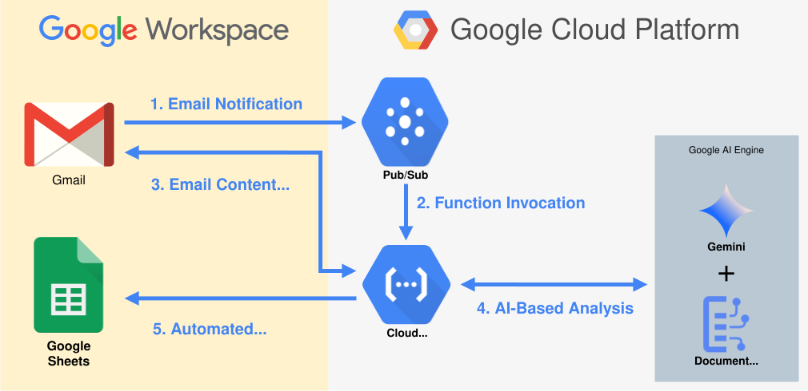

# Gmail Processing Pipeline with AI

This project is a pipeline that uses AI to automatically analyze incoming emails and extract structured data in real time.

  

It combines **Google Cloud Platform** and **Google AI services** to create a real-time, fully serverless processing pipeline to automate any process on your **Google Workspace** or even communicate with other platforms.

---

## Architecture Overview

1. **Email Notification**  
   Gmail is monitored using the Gmail API’s `watch()` method. When a new message arrives, a Pub/Sub notification is sent.

2. **Function Invocation**  
   The Pub/Sub event triggers a Google Cloud Function, initiating the pipeline.

3. **Email Content Retrieval**  
   The Cloud Function fetches the email body and attachments via the Gmail API for further processing.

4. **AI-Based Analysis**  
   Attachments and content are processed using AI services such as **Document AI** and **Gemini** to extract structure, context, or insights.

5. **Automated Data Storing**  
   The extracted data is stored (in this demo: to **Google Sheets**). In future use cases, this step can trigger **any automated output action** — such as sending alerts, replying to the email, or calling other systems.

> 💡 Steps 1–3 form the core **communication layer**, while Steps 4–5 are **modular and customizable**, enabling flexible output workflows.

---

## Setup Instructions

Each part of the infrastructure can be setup following the specific instructions:

1. **Google Cloud Setup** – create a project, enable APIs and configure a service account. [See instructions](infra/google_cloud_setup.md)
2. **Gmail OAuth** – register an OAuth client and authorize your Gmail account. [See instructions](infra/oauth_setup.md)
3. **Secret Manager** – upload the Gmail token for the function to use. [See instructions](infra/secrets_setup.md)
4. **Gmail Watch & Pub/Sub** – create a Pub/Sub topic and register a watch. [See instructions](infra/pubsub_setup.md)
5. **Deploy the Gmail Listener** – build and deploy the Cloud Function. [See instructions](functions/gmail_listener/README.md)
6. **Local Setup** – install dependencies and run local helpers. [See instructions](docs/local_setup.md)

### Terraform deployment (optional)

You can provision the core Google Cloud resources—including required APIs, service accounts, Pub/Sub, Secret Manager, and the Gmail listener Cloud Function—using Terraform. See [infra/terraform/README.md](infra/terraform/README.md) for details.

> Note: OAuth client creation and Gmail token generation are interactive steps and cannot be automated with Terraform. Follow the [Gmail OAuth setup](infra/oauth_setup.md) first and then upload `token.pickle` to Secret Manager.

See the `infra/` and `docs/` folders for full step-by-step instructions.
